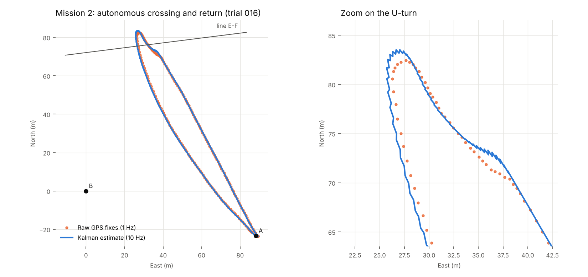
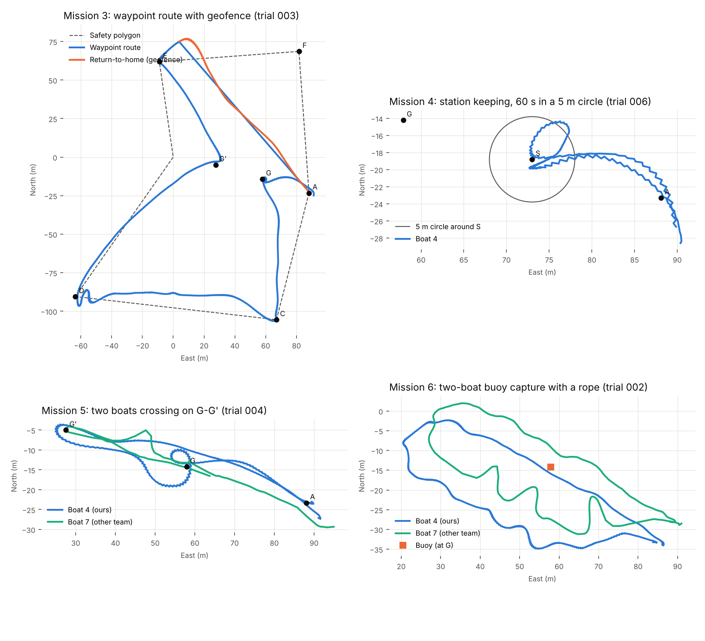
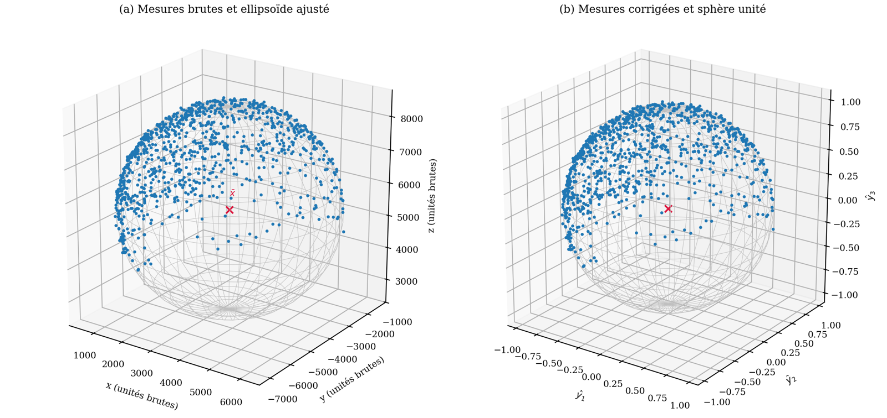

# DDBoat 4: autonomous surface vessel at Lake Guerlédan

Autonomous navigation and two-boat cooperation for a small differential-drive boat
(DDBoat), developed by team 4 during ENSTA's robotics field week at Lake Guerlédan,
France (19–23 October 2026). The boat has no rudder: it steers by changing the
speed of its two thrusters.

Over the week the team flew six missions on the lake, from heading control up to a
cooperative buoy capture with another team's boat. Every result below comes from a
real trial log in [`results/logs/`](results/logs).



## Results

| Mission | Goal | Result on the lake |
|---|---|---|
| 1. Heading control | Hold a heading, turn 360° on one thruster, manual teleop | 16 full turns, 357° on average at stop |
| 2. Crossing and return | Cross line E-F, then come back to A along a potential field | Stopped 0.98 m from A after 263 m (209 s); all 207 GPS fixes accepted by the filter |
| 3. Waypoint route | Follow 8 legs inside a safety polygon, avoid other boats, report position to a server | The current pushed the boat out near E; the geofence triggered return-to-home, which stopped 1.94 m from A |
| 4. Station keeping | Stay 60 s within a 5 m circle around S, then return | 60 s reached in all 5 trials of the final version; return within 2 m |
| 5. Two-boat crossing | Cross another team's boat on segment G-G' without collision | 4 complete trials, all ending within 2 m of A; 10.0 m minimum real separation |
| 6. Buoy capture | Two boats linked by a 20 m rope catch and tow a buoy | Trial 002 completed the 3-stage plan in 379 s; later trials stalled in strong current |



The full analysis, in French, is in the [mission report](docs/Rapport_DDBoat_4.pdf).

## How it works

**Heading.** The magnetometer is calibrated with an ellipsoid fit (hard- and soft-iron
correction, 1000 samples, corrected norm 1.00 ± 0.01). The mission scripts use a
lighter 2D calibration, since the boat stays flat on the water. Heading is held by a
proportional controller (k<sub>p</sub> = 60 per rad) at 10 Hz with a sawtooth-wrapped error.



**Position.** GPS (about 5 m accuracy on the lake) is projected into a local ENU frame
and filtered by a linear Kalman filter: constant-velocity model on each axis,
σ<sub>a</sub> = 0.3 m/s², σ<sub>GPS</sub> = 2 m. It predicts at 10 Hz between 1 Hz fixes, rejects fixes
outside a 99 % χ² gate, and resets after 5 consecutive rejections. On mission 2 the
estimate stays within 0.44 m of the raw fixes on average (3.2 m at most, in the U-turn,
where the constant-velocity model lags).

**Guidance.** Each leg is a potential field: attraction to the target point plus
attraction to the leg's segment, with a 1/d repulsion from other boats. A Petri-net
style supervisor chains the legs.

**Cooperation.** Boats exchange positions through a UDP server with about 2 s of
latency and unsynchronised clocks. Missions 5 and 6 therefore start on server events
(both boats still for 5 readings), predict the partner's position to compensate for
the delay, and freeze the shared reference when the partner falls behind.

**Safety.** Geofence with automatic return-to-home, motor stop on stale GPS, motors
zeroed on Ctrl+C, and a guard against two programs driving the serial port at once.

## Repository layout

```
guerledan/   mission scripts flown at Guerlédan (mission1.py ... mission6.py) and the UDP client
results/     curated logs (CSV + KML) of the trials shown above
docs/        mission report (French), figures
tools/       log plotting, KML export, make_figures.py (regenerates the README figures)
ddboat/      modular library written alongside the missions: hardware abstraction (real boat,
             Unity, Python simulator), estimation, control, guidance, mission runner, safety
tests/       60 unit tests for the library (python3 -m unittest discover -s tests)
sim/         Python simulator
src/         ENSTA DDBoat drivers, unmodified
legacy/      prototypes and test scripts from before the final mission scripts
```

The mission scripts run on the boat's Raspberry Pi 3 (Python 3.5) with the ENSTA
drivers: `python3 guerledan/mission3.py`. The `ddboat/` library was validated in
simulation and by the unit tests; the missions on the lake were flown with the
standalone scripts in `guerledan/`. Library details (in Portuguese) are in
[`docs/ddboat-library-pt.md`](docs/ddboat-library-pt.md).

To regenerate the figures on a PC: `pip install matplotlib`, then `python tools/make_figures.py`.

## Team

Felipe Martins, Henrique Kado and Thiago Grangeiro (equal contribution), supervised by
Luc Jaulin and Natacha Caouren. The theory follows Luc Jaulin's *DD-Boats* course notes.
Missions 5 and 6 were run jointly with DDBoat 7, whose code belongs to its own team.

MIT license.
